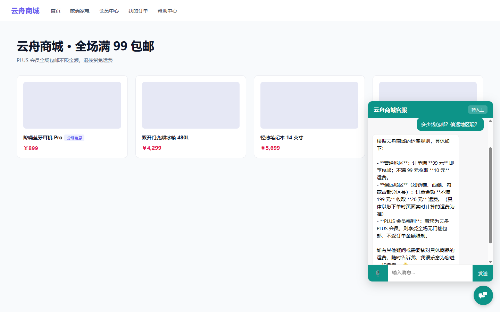
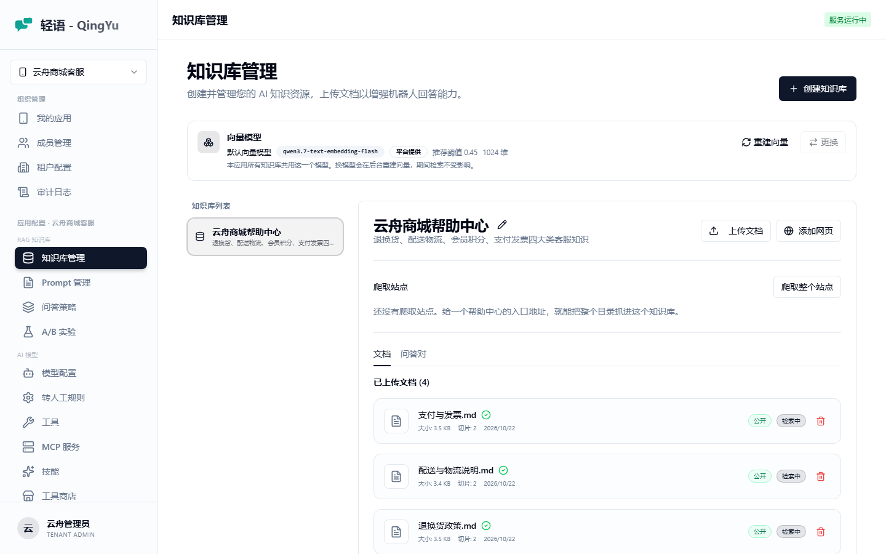
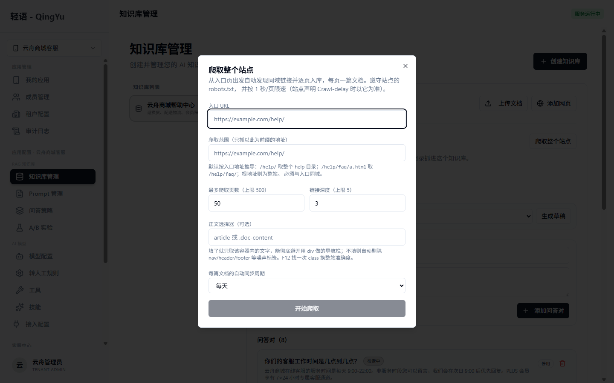
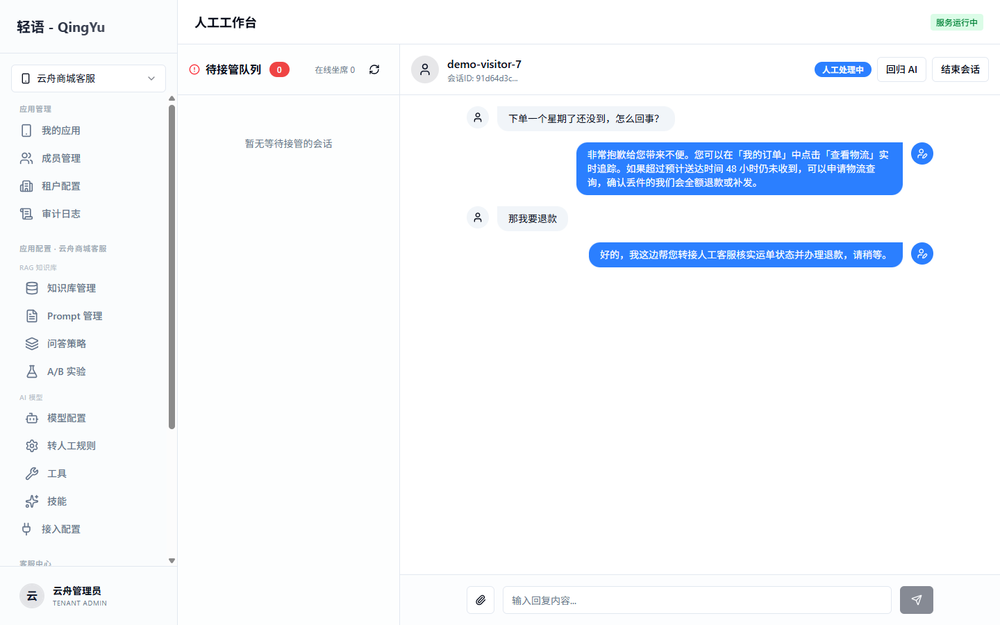
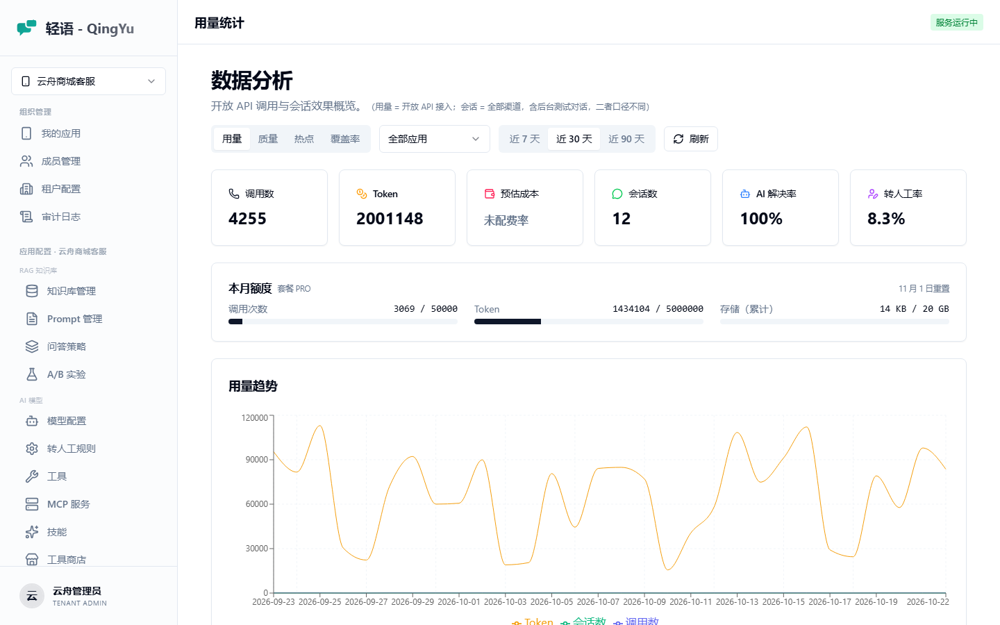
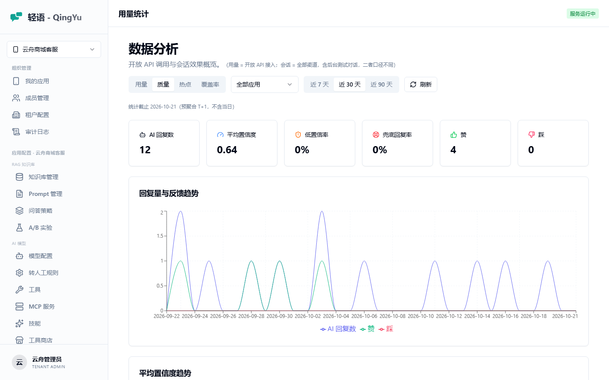
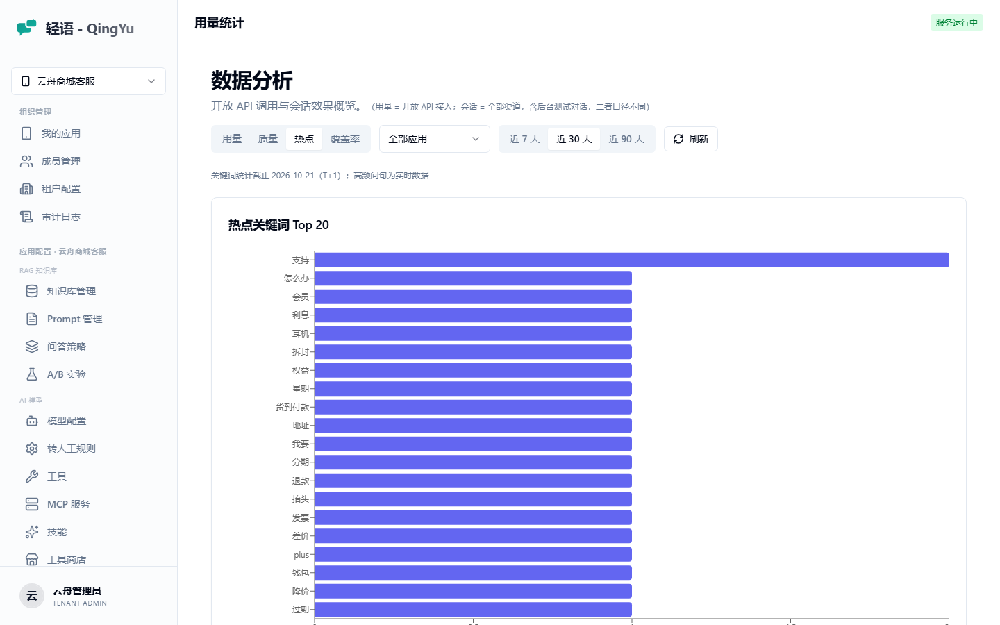

# 轻语 (QingYu Care)

<p align="center">
  <strong>🤖 面向企业的 AI 智能客服 SaaS 平台</strong>
</p>

<p align="center">
  Spring Boot 4.1 + Spring AI 2.0 + pgvector 构建，多租户、多应用、RAG 知识库问答、人工接管、开放 API 与可嵌入 Widget
</p>

<p align="center">
  <a href="#-快速开始">快速开始</a> ·
  <a href="./docs/使用手册.md">使用手册</a> ·
  <a href="./docs/部署文档.md">部署文档</a> ·
  <a href="./SaaS平台规划.md">路线图</a>
</p>

---

<p align="center">
  
</p>

<p align="center"><i>一行 <code>&lt;script&gt;</code> 嵌进任意网站，访客提问由知识库检索增强作答，可随时转人工</i></p>

## 这是什么

给企业做客服机器人的一整套后台。上传帮助文档或直接爬一个帮助中心，就得到一个能回答业务问题的客服；答不上来时按规则转给人工坐席。平台侧支持多租户，每个租户下可开多个应用（机器人实例），数据两级隔离。

对接方式有三种：管理后台自带对话页、`/open/v1/**` 开放 REST API、一行 script 嵌入的 JS Widget。

## ✨ 功能特性

### 知识与问答

- **知识库管理** — PDF / Word / Excel / PPT / HTML / Markdown 等多格式解析（Apache Tika），自动切分与向量化
- **网站知识库** — 直接给 URL 抓正文入库，按周期自动同步；内容没变不重嵌，不白烧 embedding 的钱
- **站点爬取** — 给一个帮助中心入口地址，按范围前缀 BFS 把整个目录抓进知识库，遵守 `robots.txt` 与限速
- **QA 问答对** — 整条「问+答」嵌成单向量，适合高频短问题；支持从文档一键生成草稿再人工复核
- **RAG 智能问答** — pgvector 向量检索增强生成，多轮上下文对话
- **高级检索** — 多知识库联合检索、混合检索（向量 + zhparser 中文关键词 FTS，RRF 融合）、文档权限分级（PUBLIC / INTERNAL 按鉴权路径判定）
- **问答策略中心** — TopK、相似度阈值、兜底话术数据库动态配置，租户可覆盖平台默认
- **Prompt 管理** — 模板版本管理与激活 / 回滚
- **多模型管理** — 多提供商模型配置，按场景优先级路由与自动降级

### 对话体验

- **流式对话** — SSE 逐字输出，支持中途停止生成
- **结构化卡片** — LLM 内联 ```spec 围栏产出生成式 UI，管理端与 Widget 两端纯 DOM 渲染，卡片按钮支持打开链接 / 发消息 / 复制三类动作
- **多媒体消息** — 访客与坐席互发图片和文件；私有桶 + 带鉴权的代理端点下发，不暴露对象 URL
- **工具调用与 Skill** — 挂 HTTP 工具让模型按需调用，带 SSRF 硬门槛
- **人工接管** — 关键词 / 低置信度 / 连续未命中多策略触发，含坐席工作台与双向实时通道

### 平台能力

- **多租户架构** — 租户 / 应用 / 用户三级模型，`tenant_id` + `app_id` 两级隔离（Hibernate Filter + AOP 全自动）
- **认证与权限** — Sa-Token，平台管理员 / 租户管理员 / 租户成员三种角色
- **开放 API** — `/open/v1/**`，服务端 `X-Api-Key` 与浏览器 Origin 白名单双路径鉴权，限流 + 用量计量
- **JS Widget** — 一行 script 嵌入，Shadow DOM 隔离样式
- **Webhook** — Redis Stream 队列投递 + HMAC-SHA256 签名 + 退避重试，Redis 故障自动回退直投
- **计费与套餐额度** — FREE / PRO / ENTERPRISE 三档，调用次数与 token 双维度月度额度，超额 403
- **用量与分析** — 用量趋势看板、对话质量评估、热点问题统计、知识库覆盖率分析
- **A/B 测试** — 问答策略变体实验，会话级权重分桶与变体质量对比
- **审计日志** — 关键写操作自动记录，敏感字段脱敏
- **配置中心** — 平台级 / 租户级两级键值配置，共享模型池

### 规划中

- ⏸ 多渠道接入（微信公众号 / 企业微信 / 钉钉 / 飞书）—— 暂缓，待外部账号与公网回调条件具备后启动

> 详细路线图见 [`SaaS平台规划.md`](./SaaS平台规划.md)。

## 📸 界面预览

| 知识库管理 | 站点爬取 |
|---|---|
|  |  |

| 人工工作台 | 用量统计 |
|---|---|
|  |  |

| 效果分析 | 热点问题 |
|---|---|
|  |  |

> 全部截图见 [`docs/images/`](./docs/images/)，均基于内置演示数据实拍。

## 🛠️ 技术栈

### 后端

| 技术 | 版本 | 说明 |
|------|------|------|
| Java | 17 | LTS |
| Spring Boot | 4.1.0 | 应用框架 |
| Spring AI | 2.0.0 | AI 能力集成（OpenAI 兼容模式） |
| 通义千问 DashScope | - | 默认 LLM 与向量模型；可切任意 OpenAI 兼容端点 |
| PostgreSQL | 17 | 主数据库 |
| pgvector | - | 向量存储，HNSW 索引 + 余弦距离 |
| zhparser | - | 中文分词，供混合检索的关键词路使用 |
| Sa-Token | 1.45.0 | 认证与权限 |
| Apache Tika | 3.3.1 | 文档解析 |
| Jsoup | 1.23.1 | 网页正文抽取 |
| X File Storage | 2.3.0 | S3 兼容对象存储（对接 RustFS） |
| Bucket4j | 8.19.0 | 限流 |
| springdoc-openapi | 3.0.3 | Swagger UI |

### 前端

| 技术 | 版本 | 说明 |
|------|------|------|
| React | 19 | UI 框架 |
| TypeScript | 5.9 | 类型系统 |
| Vite | 7 | 构建工具 |
| Tailwind CSS | 4 | 样式 |
| shadcn 风格 + Radix UI | - | 组件库 |
| Zustand | 5 | 状态管理 |
| React Router | 7 | 路由 |
| Recharts | 3 | 图表 |

### 基础设施

PostgreSQL 17（自定义镜像 `qingyu/pgvector-zhparser:pg17`）· RustFS（S3 兼容对象存储）· Redis 7（限流 / Webhook 队列 / 实时通道）

## 📁 项目结构

```
qingyu-care/
├── backend/                 # 后端服务（Spring Boot）
│   ├── src/main/java/com/qingyu/care/
│   │   ├── annotation/      # 自定义注解（如 @AuditLog）
│   │   ├── config/          # 配置类（多租户上下文/切面/过滤器、AOP、演示数据播种）
│   │   ├── controller/      # REST 控制器（含 open/ 对外开放 API）
│   │   ├── dto/             # 数据传输对象
│   │   ├── entity/          # JPA 实体
│   │   ├── event/           # 领域事件（Webhook 发布）
│   │   ├── repository/      # 数据访问层
│   │   ├── scheduler/       # 定时任务（会话超时、网页同步、附件清理）
│   │   └── service/         # 业务逻辑（web/ 网站知识库、media/ 附件、webhook/ 投递、tool/ 工具）
│   ├── src/main/resources/
│   │   ├── application.yml  # 主配置
│   │   ├── migration/       # 手工执行的存量数据迁移 SQL
│   │   └── static/widget.js # Widget 构建产物（由 widget/ 子项目构建后入库）
│   └── Dockerfile
├── frontend/                # 管理后台（React + Vite），含 Dockerfile 与 nginx.conf
├── widget/                  # 可嵌入网页的 Widget SDK（独立子项目，产物 widget.js）
├── docker/                  # 基础设施编排（开发版与生产版 compose）
├── docs/                    # 使用手册、部署文档、开发流程、截图与开发存档
├── .env.example             # 环境变量模板
└── SaaS平台规划.md          # 产品与技术路线图
```

## 🚀 快速开始

### 环境要求

JDK 17+ · Maven 3.9+ · Node.js 20+ 与 pnpm · Docker & Docker Compose

### 1. 启动基础设施

```bash
cd docker && docker compose up -d   # PostgreSQL(pgvector+zhparser) + RustFS + Redis
```

`docker/init.sql` 在 PostgreSQL 首次启动时创建 `vector` 与 `zhparser` 扩展；业务表由后端启动时通过 JPA `ddl-auto: update` 自动建立。

### 2. 配置 API Key

```bash
cp .env.example .env      # 然后填入真实的 DASHSCOPE_API_KEY
export DASHSCOPE_API_KEY=sk-your-key
```

> ⚠️ **`AI_BASE_URL` 必须自带 `/v1`**，正确值是 `https://dashscope.aliyuncs.com/compatible-mode/v1`。
>
> Spring AI 2.0 起改用官方 openai-java SDK，只往 baseUrl 后拼 `chat/completions` 与 `embeddings`，**不再补 `/v1`**（1.x 的 `OpenAiApi` 拼的是 `/v1/xxx`，契约已翻转）。缺 `/v1` 会让对话、文档摄取、知识检索**全线 404**。换任意 OpenAI 兼容端点同理。

### 3. 启动后端

```bash
cd backend && mvn spring-boot:run -Dspring-boot.run.profiles=dev
```

**想直接看效果？**带上 `demo` profile，自动播种一整套演示数据——一个虚构电商公司的租户、两个应用、含 4 篇文档和 8 条 QA 的知识库（走真实摄取管线，向量真实可检索）、12 组历史会话、30 天用量与分析数据：

```bash
mvn spring-boot:run -Dspring-boot.run.profiles=dev,demo
```

演示账号：`demo_admin` / `demo123456`（租户管理员）、`demo_agent` / `demo123456`（坐席）。
播种是幂等的，重复启动不会重复写入。

### 4. 启动前端

```bash
cd frontend && pnpm install && pnpm dev
```

### 5. 访问

- 管理后台：http://localhost:5173
- API 文档（Swagger）：http://localhost:8080/api/swagger-ui.html
- 健康检查：http://localhost:8080/api/actuator/health

### 6. 嵌入 Widget

在「接入配置」页拿到 appKey，把这行贴进目标网站的 `</body>` 前：

```html
<script src="http://localhost:8080/api/widget.js?appKey=YOUR_APP_KEY"></script>
```

嵌入页的域名需要先加进该应用的「Widget 允许来源域名」白名单。

## 🐳 生产部署

一条命令拉起全栈（PostgreSQL + Redis + RustFS + 后端 + 前端）：

```bash
cp .env.example .env      # 填入真实凭据
docker compose -f docker/docker-compose.prod.yml --env-file .env up -d --build
```

反向代理、HTTPS、备份恢复、监控告警与故障排查见 [部署文档](./docs/部署文档.md)。

## 📡 主要接口

后端统一前缀 `/api`，完整接口以 Swagger 为准。

| 模块 | 说明 |
|------|------|
| `AuthController` | 登录 / 注册 / 认证 |
| `ChatController` | 管理端智能问答（含 SSE 流式） |
| `KnowledgeController` | 知识库、文档、网页文档与站点爬取 |
| `QaPairController` | QA 问答对 |
| `PromptController` / `ChatStrategyController` | Prompt 模板与问答策略 |
| `AiModelController` / `HandoverRuleController` | 模型配置与转人工规则 |
| `AiToolController` / `AiSkillController` | 工具与 Skill |
| `AgentStreamController` | 坐席实时通道（SSE 双向） |
| `TenantController` / `ApplicationController` / `UserController` | 租户 / 应用 / 用户管理 |
| `PlatformController` / `PlatformConfigController` / `TenantConfigController` | 平台概览与两级配置中心 |
| `DashboardController` / `AnalyticsController` / `BillingController` | 仪表盘、数据分析与套餐额度 |
| `AbTestController` / `AuditLogController` | A/B 实验与审计日志 |
| `open/*`（`/open/v1/**`） | 开放 API：对话（含 SSE 流式）/ 会话 / 反馈 / 附件 / Widget 配置 |

## 🔧 核心配置

| 配置项 | 默认值 | 说明 |
|--------|--------|------|
| `qingyu.care.session.timeout-minutes` | 30 | 会话超时（分钟） |
| `qingyu.care.session.max-history-messages` | 20 | 上下文最大历史消息数 |
| `qingyu.care.knowledge.chunking.default-chunk-size` | 1000 | 文档切分长度（token） |
| `qingyu.care.knowledge.chunking.default-overlap` | 200 | 切分重叠长度 |
| `AI_EMBEDDING_DIMENSIONS` | 1024 | 向量维度，须与 embedding 模型输出一致 |

> TopK 与相似度阈值等检索参数不在配置文件里，走数据库动态配置（`chat_strategy` 表 / 问答策略页面），支持租户覆盖平台默认。
>
> ⚠️ **相似度阈值是按 embedding 模型标定的**。当前默认 0.45 对应 `qwen3.7-text-embedding` 实测的分数分布（真实命中 0.57~0.73，无关噪声 0.25~0.30）。换 embedding 模型后这个刻度会整体平移，必须重新测量——测法见[使用手册](./docs/使用手册.md)。

## 📚 文档

| 文档 | 说明 |
|------|------|
| [使用手册](./docs/使用手册.md) | 面向租户管理员：建应用 → 建知识库 → 调策略 → 嵌 Widget → 看分析 |
| [部署文档](./docs/部署文档.md) | 从零部署、容器化、HTTPS、备份恢复、监控与故障手册 |
| [开发流程文档](./docs/开发流程文档.md) | 环境搭建、分支与提交规范、测试体系、多租户开发注意事项 |
| [文档索引](./docs/README.md) | 全部文档的导航 |
| [SaaS 平台规划](./SaaS平台规划.md) | 产品与技术路线图 |

## 📊 路线图

```
Phase 1  多租户基础架构   ████████████ 已完成
Phase 2  对外接入能力     ████████████ 已完成（开放 API + Widget + Webhook）
Phase 3  管理后台         ████████████ 已完成（含用量统计看板）
Phase 4  高级功能         ███████████░ 已收口（计费额度 ✅ / 高级 RAG ✅ / 分析与 A/B ✅；多渠道接入 ⏸ 暂缓）
```

## 🤝 贡献

开发环境搭建、分支规范与测试约定见 [开发流程文档](./docs/开发流程文档.md)。提交前请确保 `mvn test`、`pnpm lint` 与 `pnpm test` 全绿。

## 📄 许可证

[MIT](./LICENSE)
