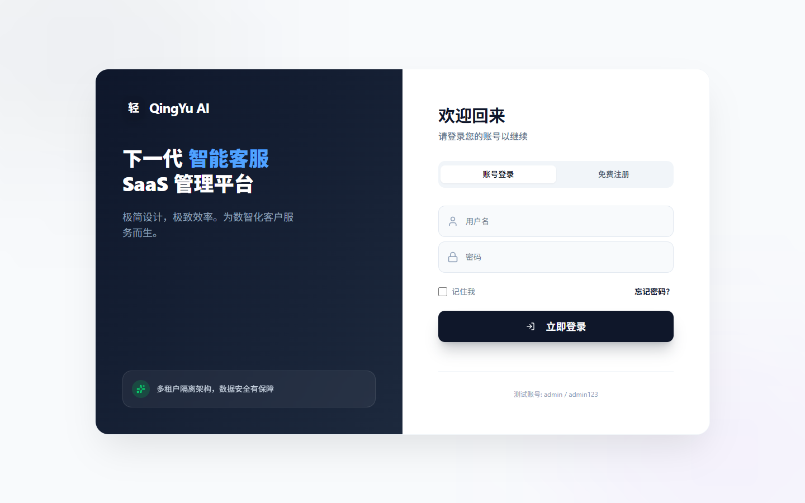
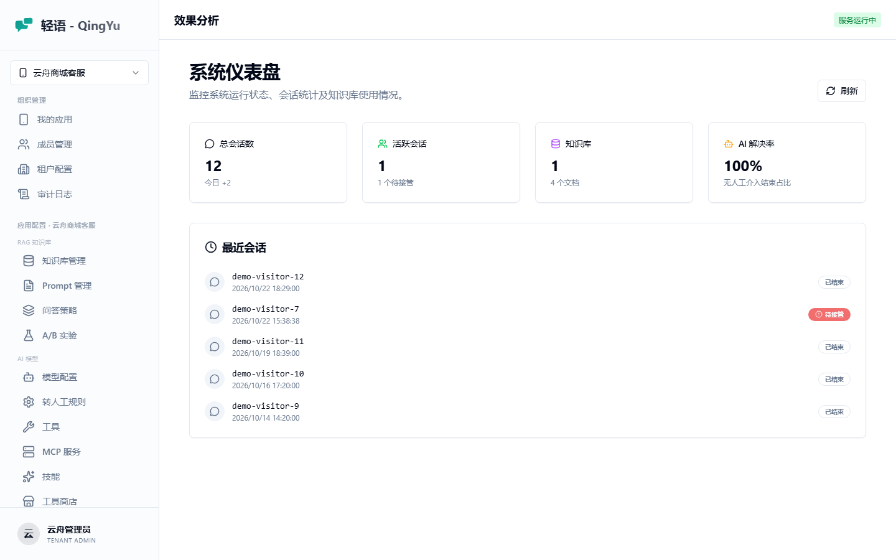
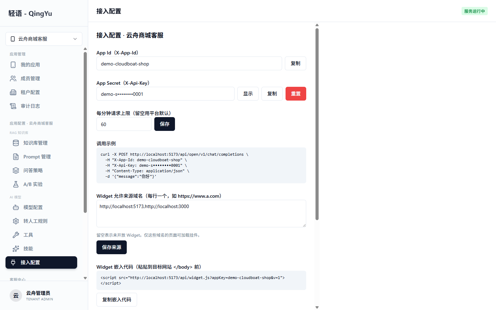
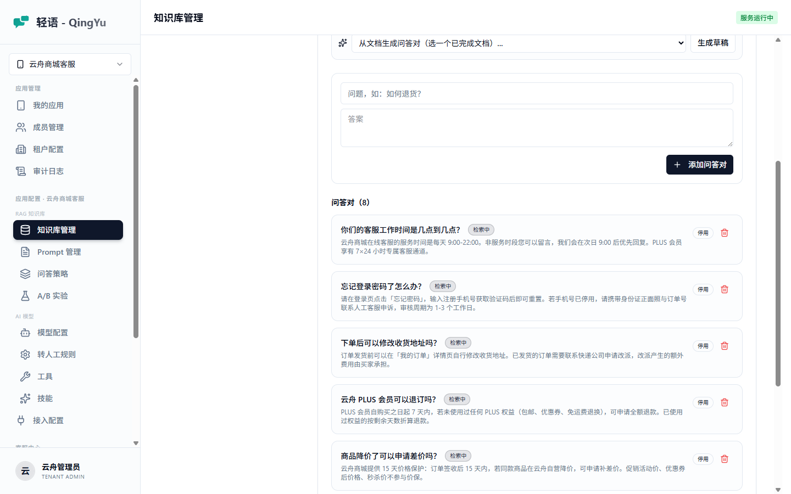
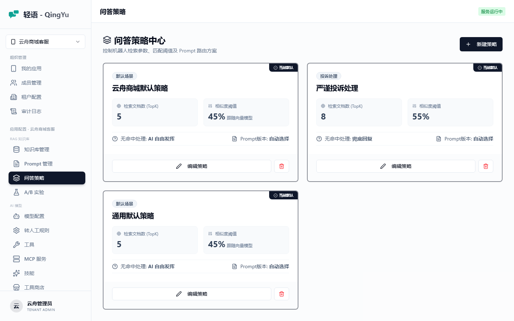
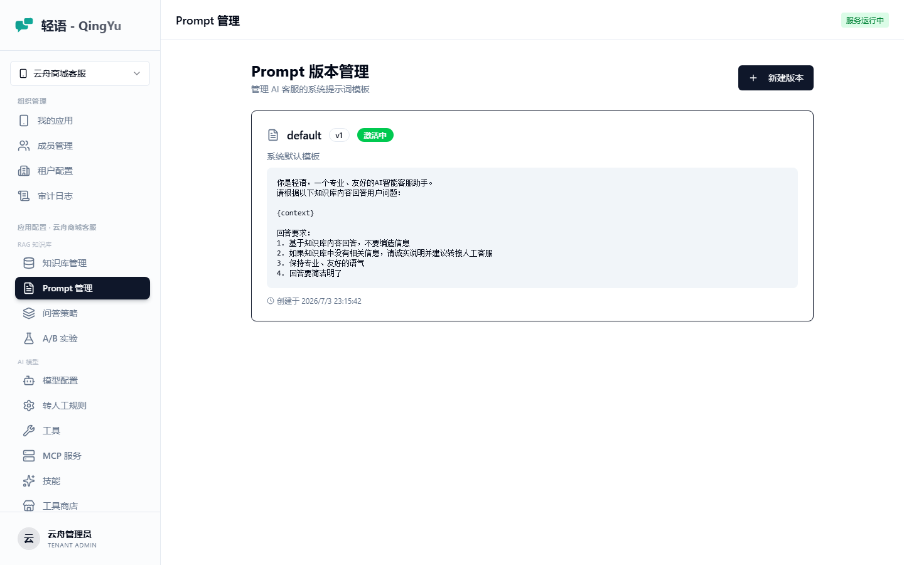
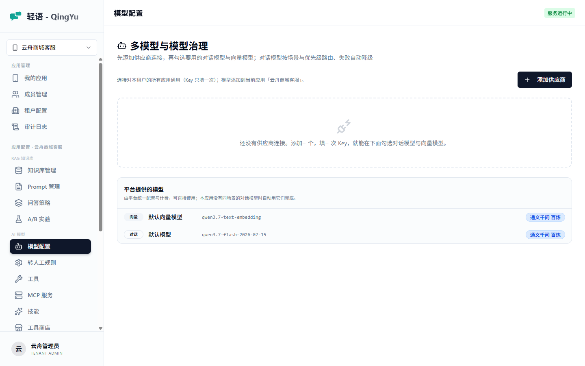
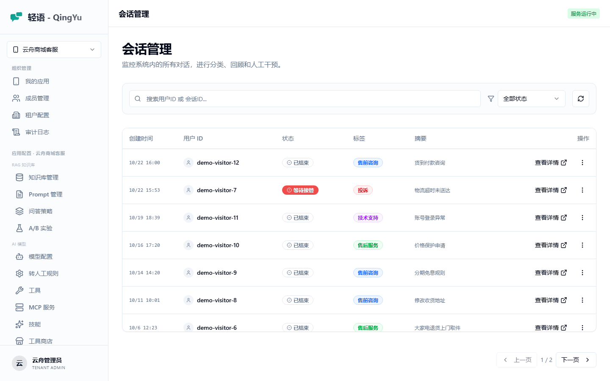

# 轻语（QingYu Care）使用手册

面向**租户管理员**的端到端操作指南：从建应用到嵌入 Widget，再到看效果、调效果。

> 本手册的截图与示例都来自内置的演示数据。想边看边跟着做，先用 `demo` profile 启动后端：
>
> ```bash
> cd backend && mvn spring-boot:run -Dspring-boot.run.profiles=dev,demo
> ```
>
> 演示账号：`demo_admin` / `demo123456`（租户管理员）、`demo_agent` / `demo123456`（坐席）。

## 目录

1. [登录与角色](#1-登录与角色)
2. [创建应用与接入凭据](#2-创建应用与接入凭据)
3. [建知识库与上传文档](#3-建知识库与上传文档)
4. [网站知识库与站点爬取](#4-网站知识库与站点爬取)
5. [QA 问答对](#5-qa-问答对)
6. [问答策略：TopK、相似度阈值、兜底](#6-问答策略topk相似度阈值兜底)
7. [Prompt 模板](#7-prompt-模板)
8. [模型配置与路由降级](#8-模型配置与路由降级)
9. [转人工与坐席工作台](#9-转人工与坐席工作台)
10. [嵌入 Widget](#10-嵌入-widget)
11. [开放 API 调用](#11-开放-api-调用)
12. [用量、额度与效果分析](#12-用量额度与效果分析)
13. [A/B 实验](#13-ab-实验)
14. [MCP 服务](#14-mcp-服务)

---

## 1. 登录与角色



系统有三种角色，看到的菜单不同：

| 角色 | 能做什么 |
|------|----------|
| **平台管理员**（PLATFORM_ADMIN） | 管理所有租户、平台级配置、共享模型池、平台概览 |
| **租户管理员**（TENANT_ADMIN） | 管理本租户的应用、成员、知识库与全部应用级配置 |
| **租户成员**（TENANT_MEMBER） | 通常作为坐席使用，主要用人工工作台 |

登录后左上角是**应用选择器**。这一步很关键——知识库、Prompt、问答策略、模型配置、接入配置这些都是**应用级**的，没选应用时这些页面显示空状态。

选好应用后，「效果分析」页给出这个应用的整体状况：



## 2. 创建应用与接入凭据

「我的应用」→ 新建应用。一个应用就是一个机器人实例，有自己独立的知识库、Prompt、策略与会话数据。

建好后进「接入配置」拿凭据：



| 字段 | 用途 |
|------|------|
| **App Id**（`X-App-Id`） | 应用的公开标识，Widget 与服务端调用都要带 |
| **App Secret**（`X-Api-Key`） | 服务端调用的密钥。**持密钥即受信**，可检索到 INTERNAL 级文档 |
| **每分钟请求上限** | 留空则用平台默认。超限返回 429 并带 `Retry-After` |
| **Widget 允许来源域名** | 浏览器侧 Widget 的鉴权方式。**留空表示不开放 Widget** |

两种鉴权路径的区别不只是形式：

- **服务端**（`X-App-Id` + `X-Api-Key`）：你自己的后端在调用，密钥不会泄漏给终端用户，因此按「受信」处理，能检索到 `INTERNAL` 文档。
- **浏览器 Widget**（`X-App-Id` + Origin 白名单）：appKey 写在页面源码里人人可见，只能靠来源域名兜底，因此按「匿名访客」处理，**只能检索到 `PUBLIC` 文档**。

> ⚠️ App Secret 一旦泄漏要立刻在本页「重置」。重置后所有用旧密钥的服务端调用会立即 401。

## 3. 建知识库与上传文档

「知识库管理」→ 创建知识库 → 上传文档。


**支持的格式**：PDF、Word、Excel、PPT、HTML、Markdown、纯文本等（Apache Tika 解析）。

**文档处理状态**依次是 `待处理 → 处理中 → 已完成`。处理中做三件事：Tika 解析出正文 → 按 1000 token 切分（重叠 200）→ 逐块调 embedding 模型转成向量入库。

列表里每篇文档有两个开关，含义容易混：

| 开关 | 含义 |
|------|------|
| **公开 / 内部** | 文档可见级别。`公开` = 所有渠道（含 Widget 匿名访客）可检索；`内部` = 仅带 API Key 的服务端调用与后台可检索 |
| **检索中 / 已停用** | 是否参与检索。停用**不删向量**，重新启用无需重嵌 |

**切分块数**（列表里的「切片」）值得留意：它决定了检索的粒度。一篇几百字的短文档只会切出 1 块，检索时要么整篇命中要么完全不中；较长的文档切成多块后，能精确命中相关的那一段。

## 4. 网站知识库与站点爬取

两个入口，用途不同：

**「添加网页」** —— 单页抓取。给一个 URL，抓正文入库，之后按设定的周期自动同步。适合少量固定页面。

**「爬取整个站点」** —— 多页爬取。给一个入口地址，自动发现同域链接并逐页入库。


各参数的实际效果：

| 参数 | 说明 |
|------|------|
| **入口 URL** | 从这里开始爬 |
| **爬取范围** | 只抓以此为前缀的地址。默认按入口地址推导：`/help/` 取整个 help 目录；`/help/faq/a.html` 取 `/help/faq/`；根地址则为整站。**必须与入口同域** |
| **最多爬取页数** | 上限 500。计的是「已尝试抓取」而非成功页数——被 robots 拒绝的不计（没发请求） |
| **链接深度** | 上限 5，从入口页算起的跳数 |
| **正文选择器** | 可选。填了就只取该容器内的文字 |
| **自动同步周期** | 每篇入库文档各自按此周期重新抓取比对 |

### 关于正文提取的一个已知局限

不填选择器时，系统按**语义标签**剔噪声：`script` / `style` / `nav` / `header` / `footer` / `aside` / `noscript` / `iframe` / `form` 会被整段移除。

问题在于这是启发式的——**用 `<div>` 做导航栏的站点**（很常见）导航文字会大量进入正文，稀释检索相似度。判断方法很直接：爬完打开任一篇文档看正文，如果混进了菜单项、Cookie 提示、页脚版权，就该填选择器了。

用浏览器 F12 找到正文容器的 class 或标签，填进「正文选择器」（如 `article` 或 `.doc-content`），重爬一次即可。

### 合规与限速

- **robots.txt 会被遵守**，被 `Disallow` 的路径不会抓取。
- **默认 1 秒/页限速**；站点在 robots.txt 里声明 `Crawl-delay` 时以它为准（有上限钳制，防止对方声明一个极大值把任务拖死）。

### 重复爬取

再次爬同一站点是安全的：内容没变的页面只更新同步时间，**不重新嵌入**，不会重复花 embedding 的钱；只有正文变了才重切重嵌。

## 5. QA 问答对



QA 与文档的区别：一条 QA 把「问题 + 答案」**整体嵌成一个向量**。用户问法与问题接近时命中度很高，适合「客服工作时间」「怎么退款」这类高频短问题——用长文档回答这类问题，往往因为相关段落被淹没在整块里而检索不到。

「从文档生成问答对」可以让模型从一篇已完成的文档里自动抽草稿，生成的是 `草稿` 状态（不入向量），**人工复核通过后才嵌入生效**。

## 6. 问答策略：TopK、相似度阈值、兜底



策略遵循「**租户自有配置 → 平台默认**」的回退：租户建了同场景的策略就用自己的，没有就用平台默认。演示数据里的「云舟商城默认策略」就是一条租户自有策略。

| 参数 | 调大的效果 | 调小的效果 |
|------|-----------|-----------|
| **检索文档数（TopK）** | 上下文更全，但可能塞进弱相关内容，也更费 token | 上下文更聚焦，可能漏掉相关信息 |
| **相似度阈值** | 只有高度相关的才进上下文，宁缺毋滥 | 更多内容进上下文，但可能混入噪声 |
| **无命中处理** | `AI 自由发挥` = 让模型凭自身知识答；`兜底回复` = 直接返回固定话术 | — |

### 混合检索（向量 + 关键词）

开启后叠加关键词检索并与向量检索结果做 RRF 融合，对专有名词、单据号等强字面匹配场景更准；关闭则退化为纯向量检索。开启时另有两个可调参数：

| 参数 | 说明 |
|------|------|
| 关键词取回条数 | 关键词路取回多少条参与融合，默认 10，越大召回越宽但越可能引入噪声 |
| RRF 融合常数 k | 融合排名的平滑常数，默认 60，越大越平均 |

⚠️ **不配置（策略行这一列为空）视为「已开启」**——这是刻意的默认语义：特性默认开，且免去对既有部署里存量策略行的 backfill 迁移。编辑弹窗里的混合检索开关会把「未配置」显示为「开」，与后端实际检索行为保持一致；关闭混合检索时两个调参 Slider 不显示。

### ⚠️ 相似度阈值必须按 embedding 模型标定，不能凭直觉

这是最容易踩的一个坑。阈值的绝对数值**只在特定 embedding 模型下有意义**，换模型后整个刻度会平移。

当前默认值 0.45 是这样测出来的（`qwen3.7-text-embedding`）：

| 问题类型 | 实测置信度 |
|---------|-----------|
| 逐字命中文档标题（「七天无理由退货」） | 0.73 |
| 正常相关问法（「多少钱包邮？偏远地区呢？」） | 0.64 |
| 换个说法（「订单满99元即可包邮吗」） | 0.57 |
| 完全无关（天气 / 写诗 / 编程） | 0.25 ~ 0.30 |

真实命中落在 **0.57 ~ 0.73**，噪声落在 **0.25 ~ 0.30**，中间有一段干净的空档。0.45 取在空档中央：噪声进不来，真命中也不会漏。

**换 embedding 模型后重新标定的方法**：

1. 把阈值临时调到 0.05（几乎不过滤）
2. 问 3~5 个「确定应该命中」的问题，再问 3~5 个「确定不该命中」的问题
3. 查两组问题各自的置信度：
   ```sql
   SELECT cm.confidence_score, cm2.content AS 问题
   FROM chat_message cm
   JOIN chat_message cm2 ON cm2.session_id = cm.session_id
                        AND cm2.role = 'USER' AND cm2.id = cm.id - 1
   WHERE cm.role = 'ASSISTANT'
   ORDER BY cm.id DESC LIMIT 20;
   ```
4. 取两组分数之间那段空档的中值作为新阈值

> 阈值设高了的症状很有迷惑性：**知识库明明有内容，问什么都答「没找到相关信息」**，而且日志里什么都没有——检索返回空是正常的 fail-soft 路径，不会报错。遇到这个症状先怀疑阈值。

## 7. Prompt 模板



模板里的 `{context}` 会被替换成本轮检索到的知识内容。支持多版本，同一场景同时只有一个版本处于「激活中」，改坏了可以切回旧版本。

## 8. 模型配置与路由降级



可以配多个模型，按场景与优先级路由，主模型不可用时自动降级到下一优先级。

> ⚠️ **端点地址必须自带 `/v1`**，如 `https://dashscope.aliyuncs.com/compatible-mode/v1`。
>
> Spring AI 2.0 只往端点后拼 `chat/completions` 与 `embeddings`，不再补 `/v1`。少了它，这个模型的所有调用都是 404。配完点「测试」按钮验证一下最省事。

## 9. 转人工与坐席工作台

「转人工规则」页可配三类触发条件：

- **关键词触发** —— 用户说了「人工」「转人工」等词
- **低置信度触发** —— 本轮检索的最高分低于设定值
- **连续未命中触发** —— 连续 N 轮都没检索到知识

触发后会话进入「等待接管」队列。坐席在「人工工作台」看到队列，点开即接管：


接管后坐席直接与用户对话，AI 不再自动回复。处理完可以「回归 AI」或「结束会话」。坐席也能发图片和文件。

> 用演示数据体验这条链路：登录 `demo_agent` / `demo123456`，工作台里有一条等待接管的投诉会话。

### 会话管理

「会话管理」页是所有会话的总账，用来回溯而非实时处理：



可以按用户 ID / 会话 ID 搜索、按状态筛选，点「查看详情」看完整对话记录。

会话状态的含义：

| 状态 | 含义 |
|------|------|
| **AI 处理中** | 正常的机器人对话中 |
| **等待接管** | 已触发转人工，在坐席队列里排队 |
| **人工处理中** | 坐席已接管 |
| **已结束** | 正常结束 |
| **已超时** | 超过会话超时时间（默认 30 分钟）无新消息，被自动关闭 |

> ⚠️ 超时只关闭「AI 处理中」和「人工处理中」的会话，**「等待接管」不受超时影响**——排队中的会话不会因为没人接就被悄悄关掉。

**标签**（售前咨询 / 售后服务 / 投诉 / 技术支持 / 其他）用于分类统计，可人工调整。

## 10. 嵌入 Widget

两步：

**第一步**，在「接入配置」的「Widget 允许来源域名」里加上要嵌入的站点域名（每行一个，如 `https://www.example.com`）。留空表示不开放 Widget，加错域名则 Widget 加载后调用会被拒。

**第二步**，把嵌入代码贴到目标网站 `</body>` 之前：

```html
<script src="http://localhost:8080/api/widget.js?appKey=demo-cloudboat-shop"></script>
```

生产环境把 `localhost:8080` 换成你的实际域名。效果：


Widget 用 Shadow DOM 隔离，不会与宿主页面的 CSS 互相污染。访客可以点赞踩反馈（数据进效果分析）、点「转人工」、发图片和文件。

## 11. 开放 API 调用

服务端到服务端用 `X-App-Id` + `X-Api-Key`。

### 非流式对话

```bash
curl -X POST http://localhost:8080/api/open/v1/chat/completions \
  -H "Content-Type: application/json" \
  -H "X-App-Id: demo-cloudboat-shop" \
  -H "X-Api-Key: demo-secret-cloudboat-shop-0001" \
  -d '{"userId":"u_1001","message":"多少钱包邮？"}'
```

返回体里带 `sessionId`（下一轮带上它即可延续上下文）、`reply`、`uiParts`（结构化卡片时用）与 `handoverSuggested`。

### 流式对话（SSE）

```bash
curl -N -X POST http://localhost:8080/api/open/v1/chat/stream \
  -H "Content-Type: application/json" \
  -H "Accept: text/event-stream" \
  -H "X-App-Id: demo-cloudboat-shop" \
  -H "X-Api-Key: demo-secret-cloudboat-shop-0001" \
  -d '{"userId":"u_1001","message":"退货运费谁承担？"}'
```

事件序列是 `start`（带 `sessionId` 与本轮 `knowledgeHits`，含每条的相似度分数）→ 若干 `delta`（逐字增量）→ 可能的 `card` → `done`。出错时是 `error` 事件。

`start` 事件里的 `knowledgeHits[].score` 就是排查检索问题最直接的依据——想知道阈值该怎么调，看这个数字比猜要快得多。

### 其他端点

| 端点 | 用途 |
|------|------|
| `POST /open/v1/chat/feedback` | 赞 / 踩反馈 |
| `POST /open/v1/chat/files` | 上传附件（先传拿 id，再发消息时带 `attachmentIds`） |
| `GET /open/v1/chat/files/{id}?sessionId=...` | 下载附件，**必须带 `sessionId`** |
| `GET /open/v1/sessions/{sessionId}` | 查会话与历史消息 |
| `POST /open/v1/sessions/{sessionId}/handover` | 主动请求转人工 |
| `GET /open/v1/sessions/{sessionId}/inbox` | SSE 订阅坐席回复 |
| `GET /open/v1/widget/config` | 取 Widget 展示配置（欢迎语、主题色等） |

> **token 计量是开放 API 专属**。管理后台里的对话不计入用量与账单，只有走 `/open/v1/**` 的调用才计量。所以用后台对话页压测不会产生用量数据。

## 12. 用量、额度与效果分析

「用量统计」页有四个标签页。

### 用量


调用数、token 数、会话数、AI 解决率、转人工率，以及 30 天趋势曲线。

「本月额度」按套餐给出双维度限制（调用次数 + token 数），两者任一超额即返回 403。额度每月 1 日自然重置。

| 套餐 | 说明 |
|------|------|
| FREE | 入门额度 |
| PRO | 标准额度 |
| ENTERPRISE | 企业额度 |

### 质量


AI 回复数、平均置信度、低置信率、兜底回复率、赞踩数与趋势。

**平均置信度持续偏低**通常意味着知识库覆盖不够，或者用户问法与文档措辞差距太大——后者可以靠补 QA 问答对来补齐。

### 热点


用户提问的高频关键词 Top 20（中文分词由 zhparser 完成）。这是发现「用户到底在问什么」最直接的入口——出现在热点里却在知识库中没有对应内容的词，就是该补文档的地方。

### 覆盖率

哪些文档被检索命中过、命中多少次。长期零命中的文档要么内容没人关心，要么措辞与用户问法对不上。

> 质量、热点、覆盖率三个标签页的数据来自**日粒度预聚合**，默认统计到昨天（T+1），当天数据次日才出现。

## 13. A/B 实验

「A/B 实验」页可以对问答策略做变体实验：设定两个或多个策略变体与流量权重，系统按**会话级**分桶（同一会话始终落在同一变体，不会中途换配置），然后对比各变体的质量指标。

适合验证「阈值调高一点是不是更准」「TopK 从 5 调到 8 有没有用」这类改动，比直接全量改上去安全。

## 14. MCP 服务

「MCP 服务」页可以接入符合 [Model Context Protocol](https://modelcontextprotocol.io/) 的远端服务器（自建的，或第三方公开的），一键同步它暴露的工具清单，标注只读后绑进技能（Skill）供对话调用——相比逐个手工配置 HTTP 工具（URL / 方法 / 参数结构全靠人填），一次接入即可拿到一整套工具，且参数结构由远端提供，不会人工抄错。

### 登记服务

点击「添加 MCP 服务」，填写：

| 字段 | 说明 |
|------|------|
| 名称 | 显示名，可中文（如「订单系统」） |
| 标识符 | 英文，`[a-z][a-z0-9_]*`，同一应用内不可重复。它会拼进模型看到的工具名（`标识符__工具名`），改了该服务下所有工具的暴露名都会跟着变 |
| 传输方式 | 目前只支持 **Streamable HTTP**；下拉里的 SSE 选项处于禁用状态（本期暂不支持，选它会配出一个保存成功、一同步就报错的服务） |
| URL | 远端 MCP 端点 |
| 鉴权头 | 可选，格式如 `Authorization: Bearer xxx`。⚠️ 保存后**不会回显**，编辑时留空表示不修改，不会清空已保存的凭据 |
| 超时 / 响应截断长度 | 出站超时（默认 10 秒，比 HTTP 工具的默认值宽，因为多一次协议握手）与回灌给模型的响应截断长度 |

### 同步工具清单

点击「同步工具」向远端拉取最新的工具列表：新增的工具**默认关闭只读、不参与对话**（未知一律当可写处理）；已存在的工具会刷新描述与参数结构，但**不会**动你已经标注过的只读状态；远端已下线的工具会标记为 `DEPRECATED`（不会被删除，只是不再对话可用、也不能在技能页勾选），方便你知道哪些技能里绑的工具已经失效。同步失败（如网络不通）不影响已有工具，只会在服务卡片上显示失败原因。

### 标注只读

MCP 工具本质上什么都能做（改订单、发邮件、删数据），协议里「是否只读」的标注是远端自己填的、可选不填、不可信。真正决定一个工具能不能被模型调用的，是这里手动打开的「只读」开关——**默认关闭**，需要逐个确认后才会生效。工具清单顶部的「按远端建议全选只读」可以一次性勾上远端标了只读建议的工具，减少逐个点击的麻烦，但最终决定权仍在你手上，务必确认这些工具确实不会产生副作用。

### 绑进技能

只读工具需要在「技能」页的工具勾选区里选中才会真正参与对话——勾选区分「HTTP 工具」与「MCP 工具」两组，后者按所属服务分组显示。删除一个 MCP 服务前会提示当前有多少个技能在用它的工具；确认删除后会连带清理所有技能里对这些工具的绑定，避免留下「界面上显示还绑着、实际已经调不到」的空绑定。

> ⚠️ MCP 工具目前只建议接只读 / 幂等的端点。调用参数由模型按技能提示词生成，服务端不校验参数内容是否合理——把写类操作暴露给模型存在被误调用的风险。

---

## 遇到问题

| 症状 | 先查什么 |
|------|---------|
| 问什么都答「没找到相关信息」 | 相似度阈值是不是太高（见 [§6](#6-问答策略topk相似度阈值兜底)）；文档状态是不是「已完成」 |
| 对话报错 / 模型调不通 | 模型端点是不是带了 `/v1` |
| Widget 加载了但发消息没反应 | 嵌入页域名是不是加进了「Widget 允许来源域名」 |
| 爬回来的正文混着导航菜单 | 填「正文选择器」（见 [§4](#4-网站知识库与站点爬取)） |
| 用量看板一直是 0 | 是不是在用后台对话页——计量只统计开放 API |
| 返回 429 | 触发了每分钟请求上限，看响应头 `Retry-After` |
| 返回 403 | 本月额度用尽，等下月重置或升级套餐 |
| MCP 工具在对话里从不生效 | 只读开关是不是没打开；有没有在技能页勾选进去；技能是否处于启用状态 |

运维层面的排查（服务起不来、SSE 不逐字输出、数据库扩展缺失等）见[部署文档](./部署文档.md)的「故障手册」。
